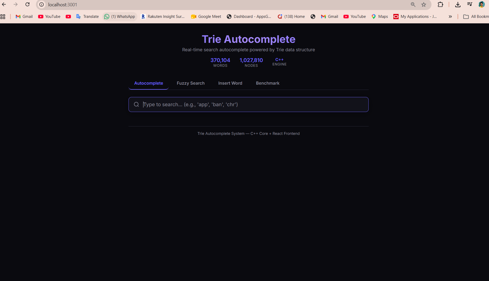
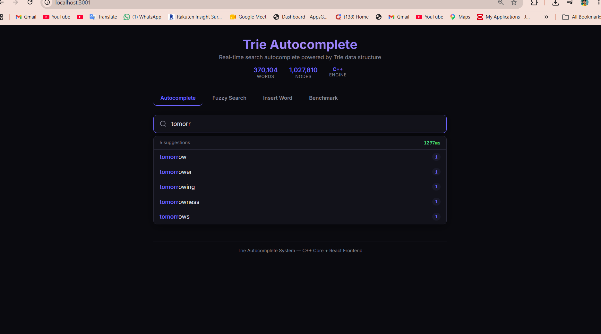
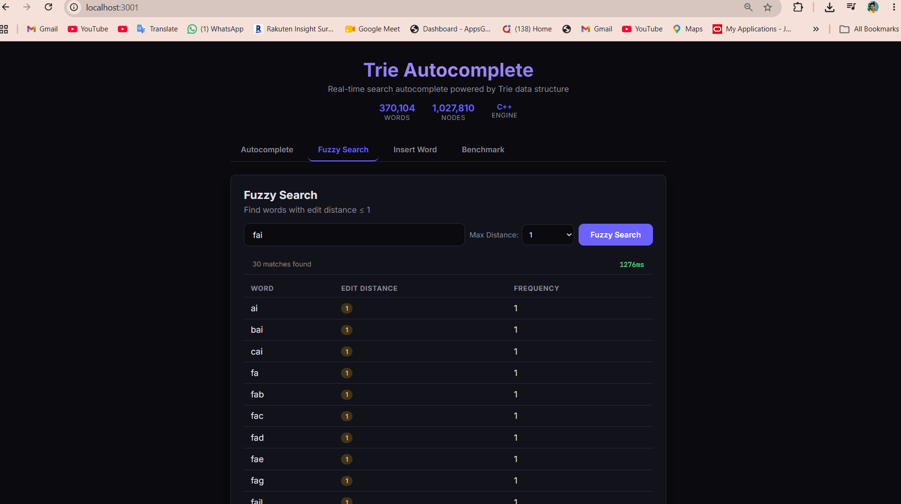
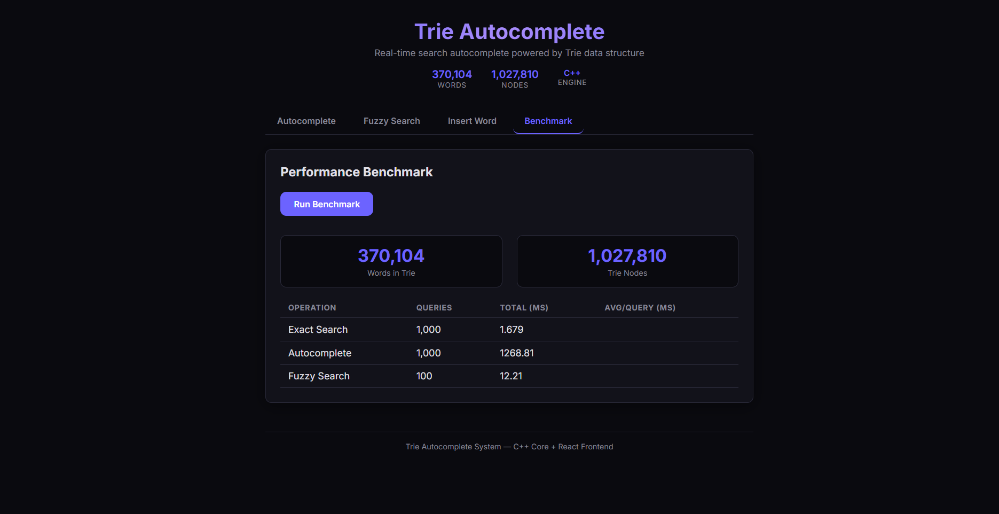
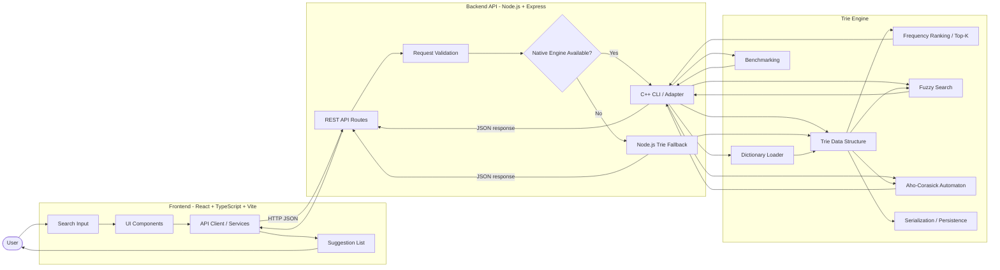
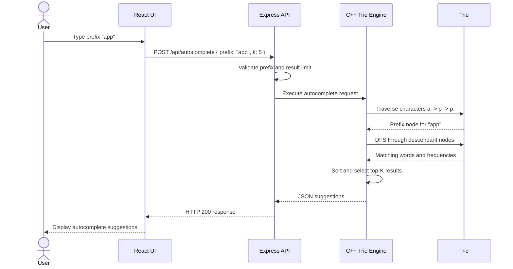
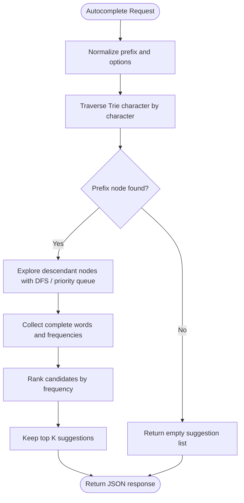

# Trie Autocomplete System

A full-stack, high-performance autocomplete system that uses a C++ Trie data structure to provide real-time word suggestions through a React interface and an Express.js API.

The system supports prefix autocomplete, fuzzy search, Aho–Corasick multi-pattern matching, dictionary loading, persistence, benchmarking, and a Node.js fallback implementation.

## Features

- **Trie-based Autocomplete** — prefix search with top-K frequency-ranked suggestions
- **Fuzzy Search** — find words within a configurable edit distance using trie pruning
- **Aho–Corasick Matching** — multi-pattern keyword matching for ACL and text-processing use cases
- **Large Dictionary Support** — load and query 370k+ words
- **Persistence** — serialize and reload trie state from disk
- **Benchmarking** — measure insert, exact search, autocomplete, and fuzzy-search performance
- **Modern UI** — React, TypeScript, and Vite frontend with real-time suggestions
- **Fallback Support** — Node.js trie implementation when the native C++ engine is unavailable

## Demo

### Landing Page



### Autocomplete in Action

Type a prefix and receive instant top-K suggestions ranked by frequency:



### Fuzzy Search

Find misspelled words within a configured edit distance. For example, searching for `aple` can return `apple`:



### Performance Benchmark

Run benchmarks for exact search, autocomplete, and fuzzy operations across the dictionary:



## System Architecture

The application is divided into three main layers:

1. **Frontend layer** — captures user input and displays suggestions.
2. **API layer** — validates requests, selects the native or fallback engine, and returns JSON responses.
3. **Trie engine layer** — performs fast prefix lookup, ranking, fuzzy matching, and other dictionary operations.



## Autocomplete Request Flow

The following flow shows what happens when a user types a prefix such as `app`:



## Trie Search Flow

For a prefix of length `m`, the Trie first traverses the prefix and then explores matching descendant nodes to produce suggestions.



## Benchmark Results

Example benchmark results for a dictionary containing approximately 370k words:

| Operation | Queries | Total Time | Average per Query |
|-----------|---------:|-----------:|------------------:|
| Exact Search | 1,000 | ~2 ms | **0.002 ms** |
| Autocomplete | 1,000 | ~2,700 ms | **2.7 ms** |
| Fuzzy Search, distance 1 | 100 | ~27 ms | **0.27 ms** |

> Benchmark results depend on hardware, compiler options, dictionary size, and whether the native engine or Node.js fallback is used.

## Quick Start

### Prerequisites

- [Node.js](https://nodejs.org/) 18+
- [g++](https://gcc.gnu.org/) or [MSYS2](https://www.msys2.org/) for the C++ backend
- CMake 3.16+
- GNU Make or MinGW Make

### Build and Run

```bash
# 1. Build the C++ backend
cd backend
mkdir -p build && cd build

# Windows with MinGW
cmake -G "MinGW Makefiles" ..

# Linux/macOS
# cmake ..

make -j4
cd ../..

# 2. Install API dependencies
cd api
npm install
cd ..

# 3. Install and build the frontend
cd frontend
npm install
npm run build
cd ..

# 4. Start the Express server
cd api
npm start
```

The server runs at `http://localhost:3001`.

### Docker

```bash
docker compose up --build
```

## Deployment

The application can be deployed as a single Docker web service. The image compiles the C++ engine, builds the frontend, and allows the Express server to serve the application on one port.

For Render:

1. Push the repository to GitHub.
2. Create a new **Blueprint** in Render and connect this repository.
3. Render reads `render.yaml` and provisions the Docker service.
4. The health check is available at `/api/health`.
5. Pushes to the configured deployment branch trigger redeployment.

To run the production image locally:

```bash
docker build -t trie-autocomplete .
docker run -p 3001:3001 trie-autocomplete
```

> **Free-tier note:** If the C++ CLI is started for every request, it may reload the 370k-word dictionary repeatedly. A persistent engine process can reduce latency for production workloads.

## API Endpoints

| Method | Endpoint | Request Body | Description |
|--------|----------|--------------|-------------|
| `POST` | `/api/insert` | `{ "word": "example" }` | Insert a word into the Trie |
| `POST` | `/api/autocomplete` | `{ "prefix": "app", "k": 5 }` | Return top-K prefix suggestions |
| `POST` | `/api/fuzzy` | `{ "word": "aple", "maxDist": 1 }` | Search for words within an edit distance |
| `GET` | `/api/benchmark` | — | Run performance benchmarks |
| `GET` | `/api/stats` | — | Return Trie statistics |
| `GET` | `/api/health` | — | Check API and engine health |

### Example Autocomplete Request

```bash
curl -X POST http://localhost:3001/api/autocomplete \
  -H "Content-Type: application/json" \
  -d '{"prefix":"app","k":5}'
```

Example response:

```json
{
  "suggestions": [
    { "word": "apple", "frequency": 980 },
    { "word": "application", "frequency": 840 },
    { "word": "apply", "frequency": 730 }
  ]
}
```

## Project Structure

```text
├── backend/
│   ├── include/          # C++ headers: Trie, Aho-Corasick, and shared types
│   ├── src/              # C++ implementations and CLI entry points
│   ├── tests/            # Google Test unit tests
│   ├── data/             # Dictionary data
│   └── CMakeLists.txt
├── api/
│   ├── server.js         # Express API server
│   ├── trie.js           # Node.js Trie fallback
│   └── package.json
├── frontend/
│   ├── src/
│   │   ├── components/   # React UI components
│   │   ├── hooks/        # Custom React hooks
│   │   ├── services/     # API clients and request helpers
│   │   └── types/        # TypeScript types
│   └── vite.config.ts
├── Dockerfile
├── docker-compose.yml
└── README.md
```

## Technology Stack

- **Core algorithms:** C++17 Trie, DFS, min-heap, edit-distance pruning, and Aho–Corasick
- **API:** Express.js running on Node.js
- **Frontend:** React, TypeScript, and Vite
- **Styling:** Custom CSS
- **Native build:** CMake and GNU Make / MinGW
- **Testing:** Google Test and project-level benchmarks
- **Deployment:** Docker and Docker Compose

## Complexity

Let `m` be the prefix length, `n` the number of matching nodes, and `k` the number of requested suggestions:

- **Trie traversal:** `O(m)`
- **Autocomplete:** approximately `O(m + n log k)` when maintaining top-K candidates
- **Exact word search:** `O(m)`
- **Insertion:** `O(m)`
- **Fuzzy search:** depends on the maximum edit distance and the number of traversed Trie states

## Future Improvements

- Keep the C++ engine alive as a persistent worker instead of launching it per request.
- Add request debouncing and response caching for repeated prefixes.
- Add authentication and rate limiting for public deployments.
- Support streaming suggestions using WebSockets or Server-Sent Events.
- Add automated frontend, API, and end-to-end tests.

## Conclusion

This project demonstrates how a Trie can power a responsive autocomplete system while integrating native C++ algorithms with a modern React frontend and Express.js API. The modular architecture makes it possible to compare native performance with a Node.js fallback and extend the system with additional search and text-processing algorithms.
